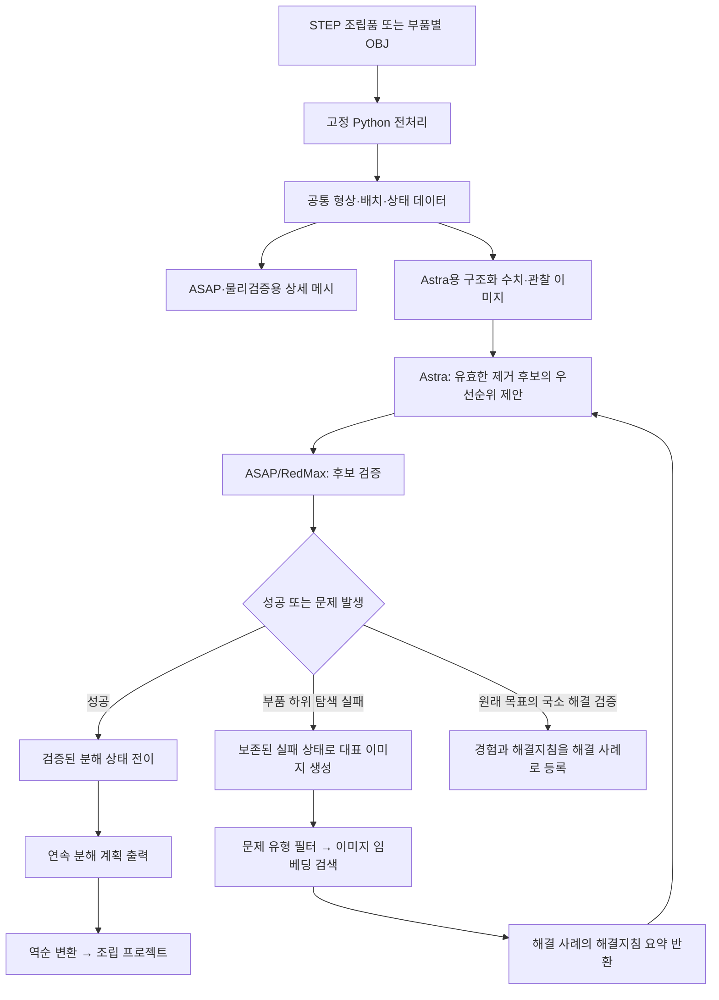

# 분해·조립 에이전트 연구 설계서

**문서 버전:** v1.0  
**작성 기준일:** 2026-11-22  
**문서 상태:** 1차 핵심 설계 유지 / 남은 운영은 추천 구현 기본값으로 정리 / Codex 인계 가능 / 새 기본값의 사용자 개별 승인·효과 검증·코드 완료를 뜻하지 않음  
**권장 저장 위치:** `docs/design/MASTER_DESIGN.md`  
**대상 프로젝트:** `llm-robot-disassembly`, `llm-robot-assembly`  
**연계 작업서:** [CODEX_HANDOFF_v1.3.md](CODEX_HANDOFF_v1.3.md)

> 이 문서는 합의한 연구 방향과 첫 구현의 시작 기준을 보존한다. v1.0은 추가 설계 논의를 계속 늘리지 않도록 남은 운영 규칙을 13절의 추천 기본값으로 정리하고, 최초 납품과 성능 평가의 완료 조건을 구별한다. 기존 사용자 합의, 새로 제안한 구현 기본값, 소스 확인, 실제 실행 검증을 구별하며 새 기본값을 사용자 확정으로 소급 표기하지 않는다. 공개 GitHub 검토에는 Codex의 미푸시·미커밋 작업이 포함되지 않는다.

## 1. 연구 목표와 범위

### 1.1 최종 목표

- CAD 기반 조립품의 **분해 계획**을 생성하고 물리적으로 검증한다.
- 검증된 **연속 분해 순서**를 역순으로 변환하여 별도의 **조립 프로젝트**에 전달한다.
- 조립 프로젝트는 로봇의 파지·이동·삽입 등을 별도로 계획하고 시뮬레이션으로 검증한다.
- 과거 문제를 해결한 사례 하나에 **경험 + 해결지침**을 축적하고, 새로운 문제에 재사용하는 계획·검증·피드백 구조를 연구한다.

### 1.2 연구 경계

- **분해 프로젝트:** 입력 생성, 상태 표현, 제거 순서 탐색, 자세·방향·지지 조건, ASAP/RedMax 물리 검증, 문제 해결과 장기 기억.
- **조립 프로젝트:** 검증된 분해 순서의 역순을 *조립 순서 후보*로 활용. 실제 조립 가능성과 로봇 동작은 별도 검증.
- 역순은 **조립 성공 보장**이 아니다. 분해 가능성과 조립 로봇의 접근성·파지·삽입·지지 조건은 다를 수 있다.
- 당장은 **분해 프로젝트부터 설계를 확정**한다. 조립 프로젝트의 세부 변경은 이후 단계에서 논의한다.
- 사례별 Python 코드 생성·실행 스킬은 **1차 범위에서 제외**한다. 해결지침은 후보 순위 판단에 활용하며, 고정 Python 코드와 ASAP의 탐색·검증 구조를 유지한다.
- **1차 경로 검사는 ASAP 기본 단일 힘 방향 검사로 고정한다.** 여러 방향을 각각 시험하되 각 시도에서는 하나의 힘 방향을 유지한다. 다단계 힘 전환·능동 회전 탐색·two-leg 복구의 기본 실행 활성화는 후속 범위다.
- 교수 보고서·발표에 사용할 **실제 실행에 근거한 영상과 이미지**를 남긴다. 사람이 보는 결과물과 Astra의 입력 정책은 별도로 관리한다.

## 2. 의사결정 상태 정의

- **확정:** 현재 합의한 연구 방향. 변경 시 의사결정 로그에 사유 기록.
- **방향 확정 / 세부 미정:** 원칙은 정했으나 알고리즘·데이터 형식·임계값 등은 미정.
- **검토 중:** 후보가 있으나 아직 합의하지 않음.
- **보류:** 초기 버전에서는 구현하지 않음.
- **현행 코드:** 과거 GitHub 검토에서 확인된 구현. 연구 설계의 확정 사항과 별개.
- **추천 구현 기본값:** 이미 합의한 원칙 안에서 첫 구현을 진행하기 위한 가역적인 선택. 사용자 개별 승인이나 최적성 검증을 뜻하지 않으며, Codex가 설정·버전을 기록해 적용한다.

## 3. 전체 시스템 아키텍처



**주의:** 위 흐름은 목표 설계다. Astra는 유효한 제거 후보의 우선순위를 제안하고, ASAP/Python이 자세·방향·경로·안정성 검증 및 탐색 상태를 관리한다. 문서에 적힌 변경이 현행 코드에 모두 연결됐다고 가정하지 않는다.

## 4. 모듈별 설계 결정 요약

| 모듈 | 결정·방향 | 상태 |
|---|---|---|
| 프로젝트 | 분해와 조립 분리; 검증된 연속 분해 체인을 역전해 조립 순서 **후보**로 사용 | 확정 |
| 모델 | 판단·해결지침 생성에 Astra 사용 | 확정 |
| 입력 생성 | 고정 Python 코드; 입력 전담 에이전트 없음 | 확정 |
| 외부 입력 | STEP/STP 우선, 부품별 OBJ + 배치·단위 정보 지원 | 확정 |
| 정적 형상 | 개별 `part_id` / 공유 `geometry_id`, 크기·중심·부피·완성 배치, 근접 관계 | 확정 / 계산 허용오차는 단위·스케일별 구현 설정 |
| 기하 전달 | 근접 부품 관계만 Astra에 전달; 원본 상세 메시와 관계 원자료는 Python 보관 | 확정 |
| 좌표·단위 | Assembly 좌표계, mm, 쿼터니언 xyzw; 원본/ASAP 변환 이력 보존 | 확정 |
| 이미지 | 최초 상면(+Z)·대각선(+X,+Y,+Z) 직교투영 2장만 새로 첨부 | 확정 |
| 추가 시각화 | 자동 가림 분석·반투명·보조 이미지·세부 특징 추출은 첫 버전에서 제외 | 보류 |
| 상태 | `state_id`, `remaining_parts`, `removed_parts`, `last_transition`; 채택된 검증 성공만 전이 | 확정 |
| Astra 호출 | **대화형**, 이전 응답 문맥 연결; Python 상태가 진실의 원천 | 확정 |
| 탐색 | Astra는 유효한 제거 후보 순위 제안; ASAP/Python은 DFS·백트래킹과 하위 검증 담당 | 역할 확정 / 운영 기본값 13절 |
| 자세·방향·지지 | ASAP의 알고리즘과 물리 검증이 담당; 후보 수·예산·고정 조건은 별도 설정 | 역할 확정 / 기존 검증 설정 유지 |
| 1차 경로 검사 | 기본 ±X·±Y·±Z 힘 후보를 각각 시험; 각 시도는 한 방향 힘 유지 | v0.7 확정 |
| 확장 경로 | 다단계 힘 전환·능동 회전 탐색·two-leg 복구를 1차 기본 실행에 연결하지 않음 | 후속 검토 |
| 사람 검토 자료 | 실제 실행 근거가 있는 최종 영상·핵심 이미지 확보; 선택 실패·해결 클립은 구현안 | 목적 확정 / 기록 범위 설정 |
| 기억 저장 단위 | 검증된 **해결 사례 하나**에 경험 + 해결지침을 함께 보관 | 확정 |
| 경험 | 객관적인 문제 상황·실제 시도·검증 결과; 검색 및 판단의 근거 | 확정 |
| 경험 시작·범위 | 대상 부품의 이번 허용 하위 탐색이 실패로 끝나 피드백·재순위로 넘어가는 경계에서 시작; Python이 범위·종료 판정 | 원칙 확정 / 사건 관리 기본값 13.3절 |
| 해결 종료 | 시작 실패 상태에서 이어지는 하나의 연속 채택 경로에서 원래 목표 부품 제거가 검증·채택되면 국소 해결; 전체 분해 완료는 불필요 | 확정 |
| 미해결 종료 | 원래 목표 해결 전 해당 시작 상태의 후속 탐색 포기·예산 종료·실행 종료 시 실행 로그만 보존 | 확정 / 로그 보존 기본값 13.3절 |
| 장기 기억 등록 | 원래 목표가 해결되고 Astra가 근거 있는 해결지침을 정리한 경우 경험 + 해결지침으로 등록 | 확정 |
| 해결지침 | 기존 교훈·스킬을 통합한 적용 조건 + 권장 후보 순위 전략; 필요시 근거 있는 이유 포함 | 구성 확정 / 생성 초기값 13.4절 |
| 사례별 실행 코드 | Python 코드 생성·실행 스킬은 1차 범위에서 제외; 고정 Python/ASAP 유지 | 확정 |
| 검색 | 경험의 문제 상황으로 해결 사례를 검색하고, 연결된 해결지침을 반환 | 확정 |
| 검색 순위 | Python이 관측된 문제 유형으로 선필터 → 문제 장면 이미지 임베딩의 상대 유사도 순위화; 복수 관측 유지 | 초기 운영 확정 / 필터·인코더 초기값 13.1~13.2절 |
| 검색 이미지 원본 | 검사기가 실패를 검출한 실제 시뮬레이션 상태를 보존해 대표 이미지 1장 생성 | v0.8 사용자 의도 확인 |
| 검색 촬영 범위 | 시도한 A를 화면 중심에 두고 가까운 주변 부품을 함께 담음; 위쪽에서 내려다보는 한 장으로 시작 | 사용자 의도 유지 / 카메라 초기값 13.2절 |
| 검색 반환 | 상위 사례의 해결지침 최대 3개(0~3개); 후보 부족 시 있는 수만, 후보가 없으면 빈 목록 | 초기 설정 상한 확정 / 변경 가능 |
| 기억 적용 판단 | Astra가 기존 순위 제안 호출 안에서 현재 상태·관계·유효 후보와 적용 조건을 비교; 반환된 지침을 모두 사용하지 않아도 됨 | 확정 |
| 기억 없이 진행 | 검색 후보가 없거나 반환된 지침이 모두 현재 조건에 맞지 않으면 현재 상태·기하·실패 피드백·유효 후보로 탐색 계속 | 확정 |
| 실패 피드백 | target_part / result / evidence 기본 3항목; 필요한 조건만 추가 | 확정 |
| Astra 기억 입력 | 해결지침 중심의 짧은 요약, 필요시 한 줄 검증 근거 | 확정 |
| 조립 연동 | 분해 결과의 역순은 후보일 뿐, 로봇 실행 가능성은 별도 검증 | 확정 |

## 5. 입력 데이터 모듈 (INPUT) — v0.2 핵심 설계 확정

### 5.1 외부 입력과 내부 표현

- **외부 입력:** STEP/STP 조립품, 또는 부품별 OBJ와 배치·단위 정보. 부품 구분이 없는 단일 OBJ에서 임의로 부품을 복원하는 기능은 범위 밖.
- **전처리:** 고정 Python 코드만 사용. Astra/다른 LLM은 입력 추출·카메라 선택에 관여하지 않음.
- **내부 원자료:** 원본 CAD, 부품별 상세 메시, 배치 변환, 부품·형상 대응, 단위, 기하 계산 결과, 입력 해시를 보존. 물리 검증은 원본 상세 형상에 근거함.
- **인스턴스 구분:** `part_id`는 개별 부품, `geometry_id`는 공유 형상. 여러 솔리드가 한 부품을 구성할 수 있음. `cad_name`은 원본 명칭일 뿐 기능 분류가 아님. 케이스/핀/덮개 같은 `semantic_type`은 근거 없으면 `null`.

### 5.2 정적 기하 JSON — 확정된 필드·원칙

- `assembly_id`, `source`, `coordinate_system`.
- 부품별 `part_id`, `geometry_id`, `cad_name`, `bbox_size_mm`, `bbox_center_mm`, `volume_mm3`, `assembly_pose`.
- `assembly_pose.translation_mm`: 부품 **로컬 원점**의 완성 조립 좌표계 위치. `assembly_pose.rotation_xyzw`: 로컬→Assembly 회전. Bounding Box 중심과 혼동하지 않음.
- 부피·거리 등 계산이 불가능하거나 신뢰성이 낮으면 `null`과 근거/상태를 기록. 부피 중심과 Bounding Box 중심은 구분.
- 부품 간 **최소 표면 거리**, 근접/접촉 허용오차 기반 관계를 Python이 계산·보관. Astra에는 **가까운 부품의 관계만** 필터링해 전달. 구체적 거리 임계값·정확도는 단위·메시 스케일에 맞춰 Codex가 설정하고 실제 출력으로 확인하며, 쌍별 계산 최적화는 병목이 확인될 때 수행한다.
- `within_tolerance`는 기하학적 근접 판정이지 접촉력·지지·이동 차단의 증명이 아님.
- 구멍·축·원통·홈·언더컷 등 상세 기하 특징 추출은 **첫 버전에서 제외**.

### 5.3 좌표·단위 — 확정

- 공통 기준은 **Assembly 좌표계**, 확인된 길이 단위는 **mm**, 회전은 쿼터니언 **`[x,y,z,w]`**.
- Part Local → Assembly → ASAP/Simulation의 변환을 명시하고 원본 단위·좌표·변환 이력 보존.
- STEP 선언 단위를 읽어 변환. OBJ에 단위가 없으면 외부 설정/데이터셋 정의를 요구하며 임의로 mm를 부여하지 않음.
- `mesh_coordinate_frame`, `assembly_pose_applied_to_mesh` 등을 기록해 배치 변환 중복 적용 방지.
- CAD의 기준 Assembly Pose와 탐색 중 조립체 전체 자세/실제 물리 자세는 별도 개념.

### 5.4 최초 관찰 이미지 — 확정

- 최초 Astra 요청에 **전체 조립체 상면도 1장(+Z에서 원점 방향)**, **대각선도 1장(+X,+Y,+Z 방향에서 원점 방향)**을 새로 첨부.
- 직교투영, 화면 자동 맞춤, CAD Assembly 좌표계 기준. 카메라와 이미지의 대응 관계를 기록.
- 후속 요청에는 **이미지를 새로 첨부하지 않음**. 단, 대화형 연결 시 최초 이미지가 이전 문맥에 포함되어 다시 과금될 수 있음.
- 자동 가시성 분석, 가림 부품 탐지, 반투명/숨김 처리, 보조 이미지, 부품별 이미지 일괄 전달은 **첫 버전에서 제외**. 기본 기하 수치로 내부 부품 배치를 보완하되, 그것만으로 이동 방향을 확정하지 않음.
- **주의:** 이 두 장은 초기 제품 관찰용이다. 문제 해결 사례의 검색 인덱스를 위한 '문제 순간 이미지 1장'은 별도 기억 모듈의 설계로 유지.

### 5.5 동적 상태 JSON — 확정

```json
{
  "state_id": "S01",
  "remaining_parts": ["P01", "P02", "P03"],
  "removed_parts": ["P04"],
  "last_transition": {"part_id": "P04", "result": "PASS"}
}
```
- **물리검증을 통과하고 실제 탐색 전이로 채택된 제거만** `removed_parts`에 반영. 실패 시 상태 불변; 실패·검증 피드백은 별도 시도 로그.
- 남은 부품의 위치는 우선 정적 Assembly Pose를 참조. 실제 물리 이동·조립체 자세 변경은 자세/물리 모듈에서 별도 정의.

### 5.6 Astra 호출 계약 — 확정

- **대화형(Stateful)** API로 이전 응답 문맥을 연결. 현행 코드의 독립 요청 방식에서 변경하는 목표 설계.
- 최초 호출: 정적 기하 JSON + 초기 동적 상태 JSON + 이미지 2장.
- 후속 호출: 최신 동적 상태 + 최소 검증 피드백 + 필요 시 검색된 해결 사례의 해결지침 요약. 최초 이미지를 새 첨부로 재전송하지 않음. 상세 전송 원칙은 8.5~8.6절.
- **Python의 검증된 상태·형상 데이터가 유일한 사실 기준**. 모델의 대화상 기억과 충돌 시 Python 데이터 우선.
- 이전 응답 연결이 문맥을 무제한 보존하거나 최초 이미지가 무료로 재사용된다는 뜻은 아님. 문맥 길이·캐시 적중·실제 입출력 토큰·재시작 시 복원 정책은 구현·실험 단계에서 확인.
- 요청/응답 ID, 상태 ID, 모델 버전, 실제 토큰/비용을 로그에 남길 것. API 호출 재시도 시 중복 상태 전이를 막을 것.

### 5.7 JSON 구조 예시 (설계 예시; 실제 값 재계산 필요)

```json
{
  "assembly_id": "battery_pack_001",
  "coordinate_system": {"reference_frame": "assembly", "length_unit": "mm", "rotation_order": "xyzw"},
  "parts": [{
    "part_id": "P08", "geometry_id": "G03", "cad_name": "battery",
    "bbox_size_mm": [18, 18, 69], "bbox_center_mm": [-10.601, 0.601, 35.5],
    "volume_mm3": null,
    "assembly_pose": {"translation_mm": [-10.601, 0.601, 1], "rotation_xyzw": [0, 0, 0, 1]}
  }],
  "nearby_relations": []
}
```
- 예시의 `bbox_center_mm` 등은 원본 재계산 없이 설명용으로 적은 값이며 검증된 출력으로 사용 금지.

### 5.8 현행 코드 연결 지점 (이전 공개 코드 검토 기준)

- `worker/independent_features.py`: 기존 기본 특징 계산 재사용.
- `worker/run_sequence_native.py`: 정적/동적 정보와 근접 관계 연결.
- `orchestrator/independent_ranker.py`, `orchestrator/sequence_knowledge.py`: 새 필드 계약 및 모델 문맥 구성.
- `orchestrator/sequence_ranker.py`, `orchestrator/llm_ranker.py`: Astra 이미지 입력·대화형 호출·응답 ID·비용 기록.
- 공개본에서는 범용 STEP 입력, 이미지 전달, 이전 응답 연결이 확인되지 않았음. 최신 로컬 Codex 변경은 구현 전에 확인 필요.

### 5.9 입력 모듈의 남은 구현 파라미터 (설계 원칙과 구분)

- 표면 거리·근접 판정의 허용 오차, 불완전 메시의 거리/부피 처리, 관계 필터의 구체 임계값.
- 카메라 up 벡터·이미지 해상도·부품 ID/색상 표기 규칙.
- API 문맥 압축·캐시·재시작 복원, 부품 수가 많을 때 정적 데이터의 재전달 정책.
- 이 항목들은 **핵심 입력 설계를 다시 여는 것이 아니라 구현 시 시험할 세부 설정**으로 기록한다.

## 6. 탐색 모듈 (SEARCH / PLANNING)

- **역할 분담:** Astra는 현재 유효한 제거 후보의 우선순위를 제안한다. 자세·방향·이동 경로를 직접 생성하는 역할로 확장하지 않는다.
- ASAP/Python이 DFS·백트래킹, 조립체 자세·힘 방향·지지 조건 탐색, 경로·안정성 검사, 채택된 상태 전이를 담당한다.
- 대상 부품에 대해 이번에 허용한 하위 탐색이 실패로 끝나 피드백·재순위로 넘어가는 경계에서 경험을 시작한다(8.3절). 방향 검사 하나의 실패마다 모델을 호출하거나 경험을 새로 시작하는 구조는 아니다.
- 방향 검사, 안정성 검사, 부품+자세 시도, 부품의 이번 하위 탐색 결과를 구별한다. 하위 검사 실패 하나만으로 부품 전체 제거 불가를 선언하지 않는다.
- 검색된 해결지침도 현재 역할 범위에 맞는 후보 순위 전략으로 적용한다. 자세·경로·물리 검증 권한은 고정 Python/ASAP에 둔다. 사례마다 Python 코드를 생성하거나 실행하는 스킬은 1차 범위에 포함하지 않는다.
- 검증된 연속 상태 전이만 최종 분해 체인으로 인정하며, 서로 다른 성공 분기를 임의로 합치지 않는다.
- 재시도·예외·마지막 두 부품 처리의 시작 기준은 13.4절을 따른다. 실제 호출·비용·시간 상한은 실행 설정과 유효한 승인 범위로 고정한다.

## 7. 자세·방향·지지 및 물리검증 모듈 (POSE / PHYSICS)

- 기준 CAD 자세와 탐색 중 조립체 자세를 구분한다.
- 이동 방향·경로·지지·안정성 검사는 물리 엔진/기하 도구의 결과를 근거로 판단한다.
- 실패 결과는 `미검증/탐색 실패`와 `물리적으로 불가능함이 입증됨`을 구분한다.
- 경로·안정성 검사가 실패를 검출한 실제 상태를 다음 시도/reset 전에 보존하는 관측 기능을 연결한다. 원래 검증 기준과 물리 동작은 유지한다. 기록되지 않은 실패 장면을 기준 CAD 배치나 새로운 재시뮬레이션 결과로 대체하지 않는다.
- 기본 힘 방향의 범위는 7.1절에서 확정한다. 조립체 전체 자세 후보 수, 그리퍼·고정 베이스, 검사 예산과 임계값은 구현 설정으로 명시한다.

### 7.1 1차 경로 검사 — v0.7 확정

- 공식 ASAP의 기본 `check_assemblable() → MultiPartPathPlanner.check_success()` 흐름을 유지한다.
- 후보는 `±X, ±Y, ±Z`이며, 각 후보를 초기 상태에서 별도로 시험한다. 한 시도 중 힘 방향을 능동적으로 바꾸는 다단계 계획은 사용하지 않는다.
- 이 결정은 **계산된 모든 위치가 정확한 직선 위에 있어야 한다는 제약이 아니다.** 이동 부품에는 회전 자유도가 있으며, 접촉 반응에 의해 궤적이나 자세가 변할 수 있다. 제어 입력이 단일 힘 방향이라는 의미다.
- 조립체 전체를 다른 자세에 놓아 검사하는 기능과, 제거 도중 대상 부품의 회전 구동을 계획하는 기능을 구별한다.
- 별도 `BFSPathPlanner`, RRT 기반 확장, `two_leg` 힘 전환 코드는 1차 기본 실행에 활성화하지 않는다. 기존 실험 코드를 삭제해야 한다는 뜻은 아니다.
- 선택된 전체 물리 궤적이 있으면 영상과 재현을 위해 보관한다. 단일 action만으로 항상 원래 실행의 모든 프레임을 복원할 수 있다고 가정하지 않는다.

### 7.2 실패 의미와 경험 적용 범위

- 실패는 **현재 입력·자세·지지·검사 방식·예산에서 제거 경로를 찾지 못했다**는 의미로 기록한다. 모든 가능한 경로에 대한 물리적 불가능으로 일반화하지 않는다.
- `T` 실패 후 `C` 제거, 이후 `T` 성공으로 얻은 해결지침은 해당 검사 조건에서 확인한 후보 순위 전략이다. `C` 선행 제거의 물리적 필수성을 증명한 규칙으로 저장하지 않는다.
- 실행과 경험에 물리 엔진/경로 정책·관련 설정 버전을 연결한다. 이후 경로 검사 범위를 바꾸면 기존 사례의 적용 조건을 검토할 수 있어야 한다.

### 7.3 확장 판단과 초기 검증

- 1차 목표는 입력 → Astra 순위 → ASAP 검증 → 경험·지침 → 검색 → 결과 자료의 실행 흐름을 완성하는 것이다.
- 대표 조립체에서 기본 검사로 의미 있는 성공·실패·순서 변경 사례가 발생하는지 초기에 확인한다. 모든 입력을 이 방식으로 처리할 수 있다고 주장하지 않는다.
- 경로 미발견이 많다는 이유만으로 다단계 경로 부재를 원인으로 단정하지 않는다. 입력·좌표·검사 조건을 점검하고, 기본 검사 실패와 확장 경로 성공의 근거가 확보되면 후속 도입을 판단한다.
- 비교 실험에서는 입력, 물리 검증, 자세·지지 조건, 예산을 맞춘다. 경로 검사 변경 효과와 Astra·기억 효과를 한 변경으로 섞어 설명하지 않는다.

### 7.4 공개 소스에서 확인한 범위

검토 기준은 공식 ASAP `3727e716b57e0b508c4e9ecd9fefa6953e8f72da`와 사용자 분해 저장소 `034006a7bc0de91cf6370eff0c07e6796f6e2877`이다. 이번 확인은 소스 검토이며 사용자 CAD에서 실행 성공을 확인한 결과가 아니다.

| 위치 | 확인한 기능 |
|---|---|
| 공식 `plan_sequence/feasibility_check.py`, `physics_planner.py` | 기본 여섯 힘 방향별 검사; 각 검사에서 초기화 후 하나의 힘 방향 적용 |
| 공식 `plan_sequence/sim_string.py` | 이동 대상 조인트 `free3d-exp`; 접촉에 따른 회전이 물리적으로 허용된 상태공간 |
| 공식 `plan_path/run_joint_plan.py` | 별도 BFS가 중간 상태에서 힘 구간을 누적하며 탐색; 회전 옵션 존재. 기본 주 순서 검사와는 별도 호출 경로 |
| 사용자 `worker/run_sequence_native.py` | 기본 순서 실행은 upstream 검사 사용; 별도 다단계 탐색을 자동 연결하지 않음 |
| 사용자 `worker/path_repair.py` 및 별도 실행기 | 한 번 힘 방향을 바꾸는 two-leg 실험 코드 존재; 1차 기본 실행 범위와 구분 |

근거: [공식 기본 검사](https://github.com/yunshengtian/ASAP/blob/3727e716b57e0b508c4e9ecd9fefa6953e8f72da/plan_sequence/feasibility_check.py), [공식 물리 검사](https://github.com/yunshengtian/ASAP/blob/3727e716b57e0b508c4e9ecd9fefa6953e8f72da/plan_sequence/physics_planner.py), [공식 조인트 설정](https://github.com/yunshengtian/ASAP/blob/3727e716b57e0b508c4e9ecd9fefa6953e8f72da/plan_sequence/sim_string.py), [별도 경로 탐색](https://github.com/yunshengtian/ASAP/blob/3727e716b57e0b508c4e9ecd9fefa6953e8f72da/plan_path/run_joint_plan.py), [사용자 기본 실행](https://github.com/ramen0519/llm-robot-disassembly/blob/034006a7bc0de91cf6370eff0c07e6796f6e2877/worker/run_sequence_native.py), [사용자 two-leg 확장](https://github.com/ramen0519/llm-robot-disassembly/blob/034006a7bc0de91cf6370eff0c07e6796f6e2877/worker/path_repair.py).

## 8. 경험·해결지침 모듈 (MEMORY) — v0.5 경험 범위·종료 원칙 확정

### 8.1 저장 단위와 개념

**장기 기억의 저장·검색 단위는 하나의 ‘해결 사례’다.** 사례 내부는 아래 두 구성으로 구분하며, 각각을 독립적으로 검색하는 구조는 기본안으로 채택하지 않는다.

| 구성 | 저장 내용 | 역할 |
|---|---|---|
| 경험 | 객관적인 문제 상황, 실제 시도와 관측, 검증 결과 | 검색과 해석의 근거 |
| 해결지침 | 적용 조건 + 권장 후보 순위 전략, 필요시 근거 있는 이유 | 어떤 상황에서 어떤 후보·순서를 우선 시험할지 제시 |

- 경험은 원래 문제 상황뿐 아니라 실제로 무엇을 했고 어떤 결과가 나왔는지까지 포함한다.
- 기존의 교훈과 스킬은 **해결지침 하나로 통합**한다. 적용 조건과 권장 순위 전략을 함께 적고, 이유가 필요하면 경험의 근거 범위 안에서 설명한다. 객관적 사실과 Astra의 해석은 식별 가능하게 유지한다.
- 해결지침은 Astra의 후보 순위 판단에 활용하는 재사용 지침이다. **사례별 Python 코드 생성·실행 스킬은 1차 범위에서 제외**하며, 고정 Python/ASAP가 실제 탐색과 검증을 수행한다.
- 초기에 경험·해결지침별 데이터베이스, 별도 검색 인덱스, 별도 등록 파이프라인을 필수 구조로 만들지 않는다. 구체적 저장 매체와 필드명은 구현 세부사항이다.

### 8.2 객관적 기록과 해석의 경계

- 관측된 접촉 상대, 이동량, 검사 실패, 시간 제한 등은 출처와 조건이 있는 경험으로 기록한다.
- ‘특정 부품이 유일한 원인이다’, ‘반드시 이 순서여야 한다’ 같은 원인 해석은 해당 근거가 없으면 확정 사실로 저장하지 않는다.
- 한 사례에서 해결 순서가 통과한 것은 그 사례의 성공 근거다. 다른 조립체에 일반화되거나 해결지침에 담긴 모든 이유·원인 설명이 검증됐다는 뜻은 아니다.
- 나중에 해결지침을 수정하더라도 원래 객관적 기록과 검증 근거를 추적할 수 있게 보존한다.
- 과거 사례의 부품 ID를 현재 조립체의 동일 ID와 같은 부품으로 간주하지 않는다. 역할·형상·관계를 현재 유효 후보에 대응시킨다.

### 8.3 경험 사건의 시작·종료와 장기 기억 등록 — 원칙 확정

**경험의 범위와 시작·종료는 Python이 결정하고 기록한다. Astra는 객관적인 경험을 근거로 해결지침을 정리한다.**

1. **시작:** 대상 부품 T에 대해 이번에 허용한 하위 탐색이 실패로 끝나 피드백·재순위로 넘어가는 경계에서 경험을 시작한다. 시작 실패 상태, 원래 목표 T, 실제 검사 결과를 연결해 기록한다. 방향 검사 하나의 실패마다 새 경험을 만들지 않는다.
2. **진행:** 원래 목표 T의 문제 해결을 향한 실제 시도와 검증 결과를 기록한다. 문제 상황으로 과거 해결 사례를 검색하고, Astra는 연결된 해결지침을 참고해 현재 유효 후보의 순위를 제안한다. 검색용 이미지·임베딩은 해당 사례의 근거와 연결한다.
3. **탐색·경로 기록:** ASAP/Python이 실제 시도와 상태 전이를 검증한다. 내부에서 다른 가지를 시도하거나 백트래킹할 수 있지만, 최종 해결 근거는 시작 실패 상태에서 이어지는 **하나의 연속 채택 경로**로 남긴다. 버린 가지의 시도는 별도 로그로 구분하고 성공 경로에 합성하지 않는다.
4. **해결 종료:** 그 연속 채택 경로에서 **원래 목표 T 제거가 필요한 검증을 통과하고 상태 전이로 채택되면** 국소 문제가 해결된 것으로 경험을 종료한다. 중간 부품 C 제거 성공만으로 종료하지 않으며, 전체 조립품의 분해 완료를 기다릴 필요는 없다.
5. **미해결 종료:** 원래 목표 T가 해결되지 않은 채 해당 시작 상태의 후속 탐색을 포기하거나, 후속 탐색 예산이 끝나거나, 실행이 종료되면 미해결로 종료한다. 해당 경험은 실행 로그로만 남기고 장기 검색 기억에 등록하지 않는다.
6. **등록:** 원래 목표가 해결되고 **근거 있는 해결지침이 생성된 경우에만** 객관적 경험과 해결지침을 하나의 해결 사례로 장기 검색 기억에 등록한다. 미해결 실행 로그는 13.3절의 초기 보존 정책을 따른다.

### 8.4 국소 해결 판정과 경로 연속성 — 원칙 확정

- 중간 조치가 성공한 것과 원래 문제가 해결된 것을 구분한다. 목표 T 제거 실패를 해결하려고 C를 먼저 제거했다면, C 제거만으로 해결 등록하지 않는다.
- 시작 실패 상태에서 C 제거 등 필요한 전이를 거쳐 T 제거가 검증·채택된 **하나의 연속 경로**가 있어야 한다. 서로 다른 가지의 성공 결과를 이어 붙여 해결했다고 판단하지 않는다.
- 다른 가지의 실패·성공 시도와 백트래킹은 실제 시도 기록으로 남길 수 있다. 이 기록을 최종 해결 근거인 연속 채택 경로와 구분한다.
- 여기서 해결은 **시작 상태에서 원래 목표 T를 제거하는 국소 문제의 해결**이다. 전체 분해 완료를 기다리지 않으며, 이 사례를 전체 분해 성공이나 최적성의 증거로 확장하지 않는다.
- 시작·종료와 등록의 근거는 Astra의 자연어 자기평가가 아니라 Python이 관리하는 검증기 결과와 채택된 상태 전이다.
- 동시 사건·반복 실패·중복 등록·추가 재실행·미해결 로그의 시작 기준은 13.3절의 추천 구현 기본값이다. 기존 시작·종료 의미를 유지하며 실제 구현으로 경로 연속성을 확인한다.

### 8.5 현재 실패를 Astra에 알리는 최소 입력 — 확정

최신 상태 정보가 별도로 제공된다는 전제에서 기본 항목은 세 가지다.

```json
{
  "target_part": "P03",
  "result": "경로 성공, 안정성 검사 실패",
  "evidence": "P07–P01의 초기 접촉 소실 관측"
}
```

- 위 ID와 상황은 가상 예시이며 실제 배터리 측정값이 아니다.
- `target_part`: 제거를 시험한 부품.
- `result`: 어디까지 검사했고 어떤 결과로 종료됐는지. 주어진 탐색 범위의 미성공과 물리적 불가능을 구분한다.
- `evidence`: 관련 부품·관계 등 핵심 관측. 확보하지 못했으면 `null`; 임의 원인 추정으로 채우지 않는다.
- 고정 조건·자세·시간 제한 등이 다음 판단에 영향을 주는 경우에만 `condition` 등 짧은 조건을 추가한다.
- 시간 제한이나 실행 오류는 그 결과 자체를 명시하며 경로 충돌이나 물리적 불안정으로 바꾸지 않는다.
- 시도 ID, 전체 궤적, 물리 단계 수, 상세 진단 수집 상태 등은 Python이 실행 기록에 보관한다. Astra 기본 입력에 일괄 나열하지 않는다.

### 8.6 검색된 과거 사례를 Astra에 전달하는 내용 — 확정

- 경험의 문제 상황으로 사례를 찾은 뒤, 연결된 **해결지침(적용 조건 + 권장 후보 순위 전략, 필요시 근거 있는 이유)**을 꺼낸다.
- Astra에는 재사용에 필요한 짧은 요약을 제공하고, 필요할 때 한 줄의 검증 근거를 붙인다.
- 전체 원시 경험, 과거 대화, 전체 궤적과 긴 실패 로그는 기본 전달 대상이 아니다. 내부 기록으로 보존한다.
- 검색 이미지와 임베딩은 검색 코드가 활용하며, 기본 모델 입력은 텍스트/구조화 요약이다.
- 모델용 요약 예시(가상 사례):

> 적용: 목표 부품의 경로가 발견되지 않았고, 접촉 이력에 선행 제거 가능한 주변 부품이 등장한 상황.  
> 권장 순위: 해당 주변 부품이 현재 유효 후보이면 우선 검토하고, 제거가 검증·채택되면 새 상태에서 목표 부품의 재시도 우선순위를 평가한다.  
> 근거: 과거 해당 순서의 각 단계가 ASAP 검증을 통과했다.

- 현재 실패의 관측과 과거 사례의 근거를 섞지 않는다. 과거 해결은 현재 상태에서 재검증할 후보를 제시하는 근거다.

### 8.7 최소 저장 예시와 내부 근거

| 구성 | 가상 사례 |
|---|---|
| 경험 | 시작 상태에서 T의 이번 허용 하위 탐색이 실패해 경험 시작. 같은 시작 상태에서 이어지는 연속 채택 경로로 C 제거 후 T를 재시도하여 경로·안정성 검사를 통과하고 상태 전이가 수락됨. T의 국소 문제 해결로 경험 종료. |
| 해결지침 | 적용: 목표 T 제거 시도가 실패했고, 유사한 주변 관계에서 C 역할의 부품이 유효 제거 후보인 경우. 권장 순위: C 역할의 유효 후보를 우선 검토하고, 제거가 검증·채택되면 새 상태에서 T의 재시도 우선순위를 평가. 근거: 이 사례에서 해당 순서가 검증을 통과했으며, C가 유일한 원인이라고 단정하지 않음. |

- 사례 식별자와 원본 상태·부품 매핑·시도·검증 로그·검색 이미지·임베딩의 참조는 내부적으로 보존한다.
- 이러한 내부 추적 필드는 모델용 최소 입력과 별개다. 필드 전체를 프롬프트에 넣는 계약은 아니다.
- 첫 저장·중복·지침 수정 정책은 13.3절을 따른다. 별도 지식 그래프나 자동 사례 병합은 첫 구현의 필수 기능이 아니다.

### 8.8 ASPIRE 참고 범위

- ASPIRE에서 참고한 원리는 **문제의 징후·적용 조건·검증된 해결 패턴을 재사용 지식으로 남기는 것**이다.
- 우리의 **경험 + 해결지침** 두 구성과 해결 사례 단위 저장은 현재 프로젝트의 설계 결정이다.
- 문제 유형 선필터와 장면 이미지 임베딩 순위화는 우리의 검색 설계이며 ASPIRE 논문에 같은 절차가 명시됐다고 주장하지 않는다.
- 참고 원문: [ASPIRE v2, §2.2 Skill Library 및 Appendix A](https://arxiv.org/html/2607.00272v2#S2.SS2).
- 공개 스킬 예시: [ASPIRE grasp.md](https://github.com/NVlabs/ASPIRE/blob/fa00f0ef2bc1d91d594b9aa502c22133c9f538f7/.claude/skills/iterative-debugging/skills/grasp.md).

### 8.9 해결지침 생성 프롬프트 — 초기 구현안

- 연계 설계안: [EXPERIENCE_TO_GUIDANCE_PROMPT_v0.1.md](EXPERIENCE_TO_GUIDANCE_PROMPT_v0.1.md). 객관적인 경험을 근거로 해결지침을 작성하도록 요청하는 프롬프트 초안이다.
- 초기 기본값은 연계 작업서 6절의 **zero-shot 지시문과 다섯 필드 JSON**이다. few-shot·프롬프트 비교는 첫 구현의 필수 조건에서 제외한다. 이전 독립 프롬프트 문서보다 현재 작업서의 초기 계약을 우선하며, 초안 채택은 효과 검증을 뜻하지 않는다.
- 실제 해결 사례를 통해 근거 없는 원인 설명·과도한 일반화를 피하는지, 현재 역할 범위에 맞는 후보 순위 전략을 제시하는지 검증해야 한다.

## 9. 기억 검색 모듈 (RETRIEVAL) — v0.6 초기 운영 확정

### 9.1 검색·적용 흐름 — 확정

1. Python이 실제 검증 결과에서 **관측된 문제 유형**을 정리한다. 복수 관측은 함께 유지하고 원인 추측으로 단정하지 않는다.
2. Python이 **문제 유형·검사 단계**로 해결 사례 후보를 먼저 선별한다.
3. Python이 보존된 실제 실패 검출 상태 중 대표 상태를 고정 규칙으로 선택해 렌더링하고 이미지 인코더로 벡터화한다. 상태 보존은 다음 시도/reset 이전에 수행한다.
4. 저장된 해결 사례의 **해결 전 문제 장면 이미지 임베딩**과 유사도를 비교해 순위를 정한다.
5. **해결 사례 하나**를 검색 단위로 삼고, 경험·해결지침을 각각 독립 검색하지 않는다. 상위 사례에 연결된 **해결지침을 최대 3개** 가져와 적용 조건 + 권장 순위 전략, 필요시 한 줄 검증 근거를 전달한다. 후보가 부족하면 있는 수만, 없으면 빈 목록을 반환한다.
6. Astra가 **기존 후보 순위 제안 호출 안에서** 현재 상태·부품 관계·유효 후보와 각 지침의 적용 조건을 비교한다. 반환된 지침을 모두 사용하지 않아도 되며, 별도의 LLM 검토 호출을 필수로 추가하지 않는다.
7. Astra가 유효한 제거 후보의 우선순위를 제안하고, **ASAP/Python이 실제 가능성의 검증과 채택 상태 관리를 담당한다**. 검색 결과나 Astra의 적용 판단이 검증 결과를 대신하지 않는다.

### 9.2 문제 분류

- Python이 검증기에서 관측한 결과를 기준으로 문제 유형을 정리한다. 관측이 여러 개이면 함께 유지하고 하나의 추정 원인으로 축약하지 않는다.
- 초기 태그와 필터는 13.1절을 따른다. 사건 전체 관측 목록과 대표 이미지에 대응하는 검사 결과를 구별한다.
- 원인 가설(예: 특정 부품이 막았음)은 관측 사실과 별도로 기록한다.
- 첫 구현에서 자동 필터 완화는 끈다. 같은 검사 단계·관측 결과의 적격 사례가 없으면 빈 결과로 계속한다.
- 유사도 점수는 **해결 성공 확률이 아니다**.

### 9.3 검색 이미지 촬영 정책 — v0.8 실제 상태 + v0.9 대상 중심 주변 촬영

**사용자 의도:** 문제가 발생한 시뮬레이션을 정지한 것처럼, 그 문제 상황의 실제 장면을 찍어 검색에 사용한다. 초기 기준 CAD 배치에서 만드는 대체 장면은 검색 이미지의 기본 원본으로 사용하지 않는다.

#### 원본 상태와 캡처 시점

- 구현 기준은 **검사기가 실패를 검출한 시점의 실제 상태**다. 최초로 물리적 문제가 발생한 연속 시간의 정확한 순간이라고 보장하지 않는다.
- 개별 경로·안정성 검사 실패 직후, 다음 시도/reset/시뮬레이터 교체 전에 해당 장면과 실제 물체 위치·자세를 복사해 보존한다. 같은 좌표계·장면·메시·검사 조건을 식별할 수 있어야 한다.
- 화면을 계속 띄워두고 사람이 일시정지 버튼을 누를 필요는 없다. Python이 상태를 보존한 후 동일한 상태를 렌더링해 PNG를 만들 수 있다. 원래 시도를 새로 계산한 다른 결과를 원본 프레임으로 대신하지 않는다.
- 고정 카메라·색상 강조는 표현 규칙으로 정할 수 있으나, 물체의 실제 배치와 존재 여부를 바꾸지 않는다.

| 검사 결과 | 사용할 실제 상태 | 해석의 경계 |
|---|---|---|
| 경로 미발견 | 해당 검사가 실패로 반환되는 시점의 물체 상태 | 이미지 자체가 충돌 상대나 유일한 원인의 증명은 아님 |
| 안정성 검사 실패 | 불안정 판정이 검출된 잔여 조립체의 실제 상태 | 제거 대상 T가 이미 장면에서 빠졌으면 다시 삽입하지 않음 |
| 초기 연결성 검사 실패 | 물리 진행 전 검사에 사용한 실제 초기 상태 | 실제로 없었던 붕괴·이탈 움직임을 만들지 않음 |
| 시간 초과 | 유효하게 확보된 종료 상태와 timeout 결과 | 충돌·불안정을 검출한 프레임이라고 해석하지 않음 |
| 상태 확보 전 오류 | 캡처 없음으로 기록 | 기준 CAD 이미지로 조용히 대체하지 않음 |

#### 경험 사건 경계와의 연결

- 개별 방향·자세·지지 검사에서 실패 상태를 임시 보존하는 것과, 경험 사건을 시작하는 것은 구분한다.
- **T의 이번 허용 하위 탐색 전체가 실패로 끝나 피드백·재순위로 넘어갈 때** 경험을 시작하고, 그 실패와 대응하는 보존 상태에서 대표 이미지 1장을 고른다.
- 같은 하위 탐색의 다른 방향·자세에서 T 제거가 성공했다면 앞의 실패 캡처만으로 새 문제 경험을 만들지 않는다.
- 첫 구현에서는 13.1절에 따라 해당 범위의 마지막 실패 검사를 대표로 선택한다. 그 판정·상태·이미지를 함께 연결하고 여러 검사의 상태를 한 장의 실제 장면처럼 합성하지 않는다. 대표 상태가 없으면 이미지 없음으로 기록한다.
- 사례가 해결된 뒤 결과를 보고 해결 전 문제 이미지를 새로 선택하거나 바꾸지 않는다.

#### 대상 중심 촬영 — v0.9 사용자 의도 반영

- **시도했던 대상 A를 화면 중심에 두고, A와 가까운 주변 부품의 배치가 보이는 대표 이미지 1장**을 사용한다. 전체 조립체나 모든 관련 관계를 한 장에 담도록 요구하지 않는다.
- 사용자가 말한 '위에서 정면에 두고'는 A를 중앙에 놓고 위쪽에서 내려다보는 촬영으로 해석해 초기 구현한다. 부품의 기능적 정면을 자동으로 추론하는 기능을 추가하지 않는다.
- 정확한 초기 카메라 구현안은 **시뮬레이션 월드 +Z에서 내려다보는 직교투영**, A의 실제 현재 중심을 look-at으로 사용하고 주변 범위에 맞춰 배율을 정하는 방식이다. 이는 구현 가정이며, 최초 입력 이미지의 Assembly 기준 두 시점과 별도로 기록한다.
- 기존 근접 관계와 실제 검사에서 확보된 관련 부품 정보를 촬영 범위 결정에 활용할 수 있다. 이를 실패 원인이 확인된 부품 목록으로 취급하지 않는다.
- 가까운 부분을 담는 것은 카메라 프레이밍·확대 범위를 정한다는 의미다. 실제 남아 있는 부품을 임의로 숨기거나 물체 배치를 바꾸지 않는다. 가림을 모두 해결하는 기능은 1차에 추가하지 않는다.
- A 강조색, 여백, 해상도와 주변 범위는 설정으로 두고 샘플 PNG를 확인한다. 한 장이 가림·높이·내부 관계를 모두 표현한다거나 검색 성능에 충분하다고 미리 보장하지 않는다.
- **A 제거 후 안정성 검사처럼 A가 장면에 없는 경우**, 제거 직전 A의 위치를 프레이밍 기준으로 쓰는 것을 초기 구현안으로 둔다. 실제 A는 다시 삽입하지 않는다. 관측된 잔여 문제 부품이 프레임에서 빠지지 않는지는 샘플로 확인한다.
- 대표 선택은 13.1절의 추천 초기값이며 사용자 개별 확정이나 최적 선택을 뜻하지 않는다. 이미지가 어느 시도·검사 결과에 해당하는지 연결하고, 해결 후 이미지를 유리하게 다시 고르지 않는다.
- 장면 출처·검사·시도·카메라 버전을 기록하고 저장/질의 이미지에 같은 촬영 규칙을 사용한다.
- 실제 상태가 없으면 이미지 검색 미수행 사유를 남긴다. 가짜 이미지나 테스트 벡터로 실검색처럼 보고하지 않는다.

### 9.4 이미지와 임베딩의 역할 — 확정

- **원본 이미지:** 디스크/아티팩트에 보존해 사람 검토 및 재임베딩에 사용.
- **이미지 임베딩:** 검색용 Python 코드가 유사도 계산. 과거 임베딩은 캐시·인덱싱.
- **Astra:** 검색된 사례의 해결지침 중심 요약과 필요한 검증 근거만 **텍스트/구조화 데이터로** 수신. 원시 경험 전체는 기본 전달하지 않음.
- 이미 Astra가 문제를 인지했다면 **현재 이미지나 과거 검색 이미지를 다시 Astra에 보내지 않는다**.
- 검색 사례의 기하 차이를 확인하기 위한 추가 이미지·기하 조회는 후속 검토 항목이다. 1차 기본 실행에서는 검색 이미지를 Astra에 자동 전송하지 않는다.
- 검색 인코더는 Astra와 별도 구성 요소이며, 추천 초기값은 13.2절의 DINOv2 ViT-S/14다. 실제 가중치·환경 연결과 우리 장면의 검색 효과는 아직 검증하지 않았다.
- **Astra의 대화 문맥은 이미지 인코더에 자동으로 전달되지 않는다.** 이미지 유사도 검색은 문제 유형 필터와 촬영 일관성을 함께 사용한다. 대화 문맥이 사진에 보이지 않는 구조를 검색 벡터에 채워준다고 가정하지 않는다.
- Astra에는 최신 상태와 `target_part / result / evidence` 등 새 실패 피드백을 명시적으로 제공한다. 대화형 연결만으로 새로운 시뮬레이션 결과를 자동으로 알 수 있다고 가정하지 않는다.
- 사진은 유사한 형상·배치를 찾는 근거, 검사 피드백은 어떤 문제가 관측됐는지 알리는 근거, 해결지침은 다음 후보 순위를 검토할 자료로 사용한다. 어느 하나만으로 실패 원인이나 해결 성공을 확정하지 않는다.

### 9.5 기존 코드와의 차이 (이전 검토 기록)

- 현재 기본 경로는 조립체/단계별 관측을 골고루 제공하는 방식.
- 관계 검색 경로는 형상·주변 관계·상황 점수의 순위 결합(RRF)을 사용하고, 이미지 임베딩 검색은 없음.
- 기존 검색 결과의 출처·근거 ID 연결은 재사용 후보. 기존 코드의 경험–교훈–스킬 기록을 새 경험 + 해결지침 구성에 대응시키는 방식은 구현 시 검토한다.
- 새 구조에서는 **문제 발생 시 검색**을 우선 구현. 문제 발생 전 예방 검색은 후속 검토.

### 9.6 반환 개수·적용 판단·검색 결과 없음 — 초기 운영 확정

- **반환 상한:** 유사도 순위가 높은 사례의 해결지침을 최대 3개, 즉 **0~3개** 반환한다. 3개는 초기 설정의 상한이며 이후 변경할 수 있다. 최적값으로 검증됐다는 뜻은 아니다.
- **후보 부족:** 검색 후보가 1~2개이면 있는 수만 반환하고, 후보가 없으면 빈 목록을 반환한다. 개수를 맞추려고 지침을 만들어 넣지 않는다.
- **적용 판단:** Astra가 기존 후보 순위 제안 호출 안에서 현재 상태·관계·유효 후보와 지침의 적용 조건을 비교한다. 반환된 3개 모두 사용하지 않을 수 있다. 별도 LLM 검토 호출은 필수 단계가 아니다.
- **두 상황의 구분:** 검색 후보가 없어 반환 목록이 비는 경우와, 반환된 지침은 있지만 Astra가 현재 상황에 적용하기 어렵다고 판단하는 경우를 구분한다. 어느 경우도 현재 부품의 제거 불가능을 뜻하지 않는다.
- **기억 없이 계속:** 검색 결과가 없거나 모든 반환 지침의 적용 조건이 현재 상황에 맞지 않으면, 현재 상태·기하 관계·실패 피드백·유효 후보를 근거로 기존 탐색을 계속한다. 기억이 0개여도 작동하도록 하며, 없는 사례를 해결 근거로 대신하지 않는다.
- **유사도 사용:** 초기에는 후보의 **상대 순위 정렬**에 사용한다. `0.8` 같은 절대 임계값은 검증 후 결정하며 이번에 확정하지 않는다. 유사도 점수는 성공 확률이나 물리 검증 결과가 아니다.

## 10. 모델·비용 정책

- 프로젝트의 판단·해결지침 생성 LLM은 **Astra로 통일**.
- **대화형 API 호출**을 기본으로 하며 이전 응답을 연결한다. 대화형 문맥은 무료·무제한 메모리가 아님.
- 최초 이미지 2장을 후속 요청에 새로 첨부하지 않지만, 과거 문맥의 이미지 토큰이 과금 대상일 수 있으므로 캐시/입력 토큰을 측정.
- 검색용 이미지 임베딩 인코더는 Astra와 별도. 임베딩 벡터를 Astra에 텍스트로 나열하지 않음.
- 과거 기억은 해결 사례 단위로 검색하고, Astra에는 해결지침 중심의 짧은 요약을 제공. 현재 실패의 추가 입력은 8.5절의 최소 3항목을 기본으로 한다.
- API 가격, 모델 ID, 캐싱 및 문맥 정책은 실제 구현 시 공식 문서로 재확인.
- **Astra는 이 설계에서의 모델 지정이며 외부 API의 유효한 모델 ID를 추정하는 근거가 아니다.** 사용 환경에서 실제 접근 가능한 해당 모델 ID를 설정으로 명시한다. 모델을 Sol/Luna 등으로 조용히 대체하지 않는다.
- 기존 launcher의 Sol 전용 검증 조건도 점검한다. 실제 모델·API 연동이 확인되기 전에는 mock/offline 실행과 live 실행을 구분한다.

## 11. 조립 프로젝트 전달 및 사람 검토용 산출물

### 11.1 조립 프로젝트 전달 인터페이스

- 출력은 **검증된 연속 분해 순서** 및 각 전이의 근거를 포함해야 한다.
- 부품 ID/원본 메시 매핑, 기준 완성 배치, 단위·좌표 변환, 고정·지지·자세 조건, 입력 해시, 검증 상태를 전달한다.
- 조립 프로젝트는 순서를 역전하여 **조립 순서 후보**로 사용하고 로봇 실행 가능성을 독립적으로 검증한다.
- 분해에서 사용한 이동 방향을 단순 반전한 것이 로봇의 실제 삽입 경로라고 가정하지 않는다.
- 이번 납품에는 13.6절의 공통 export v1을 포함한다. 조립 프로젝트 importer의 실제 수정과 로봇 동작 검증은 별도 작업으로 남긴다.

### 11.2 교수 보고서·발표용 시각화

**확인된 요구:** 실제 시스템 동작을 교수에게 영상·이미지로 설명할 수 있어야 한다. 실시간으로 모든 탐색을 표시하는 통합 GUI나 Isaac Sim 연동은 이번 요구의 필수 조건으로 정하지 않았다.

권장 초기 산출물은 (1) 최종 채택 분해 계획 영상, (2) 선택된 실패·해결 시도의 짧은 클립, (3) 보고서용 핵심 PNG이다. 실패 저장 개수·대표 프레임·해상도 등은 구현 설정이다.

- 각 자료를 `run_id/state_id/attempt_id` 등 실제 기록과 연결하고, 대상 부품·검사 결과·채택 여부를 식별한다. 필드명은 초기 코드 계약에서 구체화한다.
- 실제 시도 기록은 시뮬레이터 reset 전에 보존해야 한다. 초기 조건 검사에서 즉시 반환된 실패에 가상의 움직임을 만들어 붙이지 않는다.
- 최종 계획을 로그로부터 다시 계산해 만든 영상은 재생/재계산 결과로 구분한다. 원래 실패 시도의 녹화와 혼동하지 않으며, 재계산 결과가 원래 계획과 다르면 별도로 보고한다.
- 자막은 검증 로그에 근거해 선택·검색·판정을 설명한다. 영상만으로 기억의 성능 향상이 증명됐다고 주장하지 않는다.
- 상세 프레임을 모두 Astra에 전송하지 않는다. 사람 검토용 저장량과 모델 입력량은 별도다.
- 영상 저장 실패는 숨기지 않는다. 인코더·그래픽 환경 문제이면 계획 성공 상태와 매체 생성 상태를 따로 보고한다.

공식 기능 근거: [ASAP README의 결과 생성 및 Simulation Viewer](https://github.com/yunshengtian/ASAP), [검사 후 replay 호출](https://github.com/yunshengtian/ASAP/blob/3727e716b57e0b508c4e9ecd9fefa6953e8f72da/plan_sequence/feasibility_check.py), [상태 이력 및 reset](https://github.com/yunshengtian/ASAP/blob/3727e716b57e0b508c4e9ecd9fefa6953e8f72da/simulation/redmax/Simulation.cpp).

## 12. 평가 계획 — 초기 비교와 후속 연구 구분

### 12.1 입력 표현 비교 — 후속 기여 분석

- 같은 모델·탐색기·물리검증 조건에서 기존 수치 입력과 확장 수치+이미지 입력 비교.
- 결과: 검증된 분해 계획 성공률, 제거 단계 수, 탐색/검증 횟수, 시간, 모델 토큰 및 비용.

### 12.2 검색 품질 비교 — 후속 기여 분석

- 동일한 해결 사례 집합을 사용하여 기존 수치·관계 검색과 **문제 유형 필터 + 이미지 임베딩 검색** 비교.
- Top-k 관련 사례 적중률, 유사도와 실제 적용 가능성의 차이, 재사용 성공률, 추가 검사 비용 기록.
- 관련 사례의 정답/판정 기준 없이 Hit@k를 자동 성능 지표처럼 만들지 않는다. Astra가 적용 여부를 명시하지 않았다면 미확인으로 기록하고, 지침 전달이나 순위 변화만으로 실제 사용·효과를 단정하지 않는다.
- 기억이 없는 상태·검색 결과가 부적절한 상태의 기준선도 필요.

### 12.3 누수·편향 방지

- 동일 제품/동일 장면의 근접 중복이 학습 기억과 평가 집합에 섞이지 않도록 분리.
- 이미지 검색 점수와 최종 물리 성공률을 구분해 보고.
- 실험별 입력 해시, 모델·인코더 버전, 카메라 정책, 검증 설정 보존.
- 기억 수집 집합과 평가 집합을 제품·형상 계열 및 파생 지식 기준으로 분리하고, 평가 전에 데이터 목록·제외 이유·시드·반복 수·예산을 manifest로 고정한다. 평가 중 얻은 사례는 그 평가의 검색 인덱스에 추가·수정하지 않는다.
- 같은 제품을 반복한 개발 데모, 한 제품의 OFF/ON 비교, 미관측 제품에서의 일반화 평가를 구별한다. 같은 장면 반복 검색은 소프트웨어 확인이 될 수 있지만 일반화 성과로 집계하지 않는다.

### 12.4 1차 비교의 공통 조건

- 기본 경로 검사·메시/단위 변환·자세/지지 조건·시드·검사 예산을 각 비교군에서 일치시킨다.
- 최초 비교는 같은 Astra 설정의 **장기 검색 OFF / 동결 기억 검색 ON** 두 조건으로 시작한다. OFF에서도 최초 이미지·실패 피드백·대화형 운영은 동일하게 유지한다. 각 실행의 CAD/DFS 상태·예산과 Astra 대화 세션을 새로 시작한다.
- 기존 native/GNN 기준선은 보존한다. GNN 대체의 우수성을 주장하려면 해당 비교가 필요하지만, 그 전체 실험과 12.1~12.2절의 기여 분석은 첫 데모 납품의 조건이 아니다.
- 미해결 실행, 입력 오류, timeout, 미디어 생성 실패를 성공 사례와 함께 집계한다. 시연에 좋은 영상만 고르는 것과 전체 평가 대상을 고르는 것을 구분한다.
- mock 결과, 실제 물리 검증, 실제 Astra 호출, 실제 이미지 인코더 실행 여부를 구분해 보고한다.

## 13. 첫 구현을 마무리하기 위한 운영 기본값

**기존 연구 방향을 다시 결정할 필요는 없다.** 아래는 마지막 점검에서 정리한 **추천 구현 기본값**이다. 사용자 개별 확정이나 실험 효과 검증으로 표시하지 않는다. Codex는 이 범위 안의 가역적인 설정을 구현·기록하고, 확인되지 않은 사소한 값마다 작업을 멈추지 않는다.

### 13.1 실패 종류·대표 시도·검색 필터

| 항목 | 초기 기본값 |
|---|---|
| 관측 분류 | 검사 단계 `path / stability / input / runtime / unknown`와 결과를 분리한다. 실제 결과에 따라 `path_search_failed / stability_failed / initial_disconnected / timeout / input_invalid / execution_error / unknown`를 사용한다. 이 이름은 어댑터 계약이며 공식 ASAP가 그대로 반환한다고 주장하지 않는다. |
| 결과 판별 | 검증기에서 이유를 구별할 수 있을 때만 세부 결과를 붙인다. 실패 bool만 확보한 것을 임의로 timeout·충돌로 세분하지 않는다. 연결성 실패는 연결성 결과로 기록하고, 안정성 timeout을 실제 낙하로 바꾸지 않는다. |
| 대표 시도 | 대상 T의 허용 하위 탐색이 실패로 닫히는 경계에서, 해당 범위의 **마지막 실패 검사**를 선택한다. 검사 실행 순서와 ID로 재현 가능하게 고정한다. 그 검사의 판정·상태·이미지를 묶고, 이후 해결 결과에 맞춰 다시 고르지 않는다. |
| 상태 없음 | 대표 검사에 유효한 상태가 없으면 이미지 없음으로 기록한다. 더 보기 좋은 이전 장면·기준 CAD로 대체하지 않고 이미지 검색 없이 계속한다. |
| 검색 필터 | 대표 이미지와 연결된 **검사 단계 + 관측 결과가 같은** 해결 사례만 선별한다. 사건 전체의 다른 실패 관측은 별도 원자료로 보존한다. 시간 제한 사례는 시간 제한 범주로만 비교한다. |
| 기술적 오류 | `input_invalid / execution_error / unknown`은 정상 문제 이미지 검색과 분리한다. 원인을 고치거나 실행 상태를 보고하며, 부품 순위 변경으로 해결됐다고 추정하지 않는다. |
| 반환 | 적격 후보를 이미지 유사도로 정렬해 0~3개 반환한다. 자동 범주 완화와 절대 유사도 임계값은 첫 버전에서 사용하지 않는다. |

대표 선택은 단순한 시작 규칙이며 가장 설명력 있는 실패를 고른다는 보장이 아니다. 하나의 사건에 다른 관측이 함께 있었다는 사실을 지우지 않는다. 모델 피드백에도 대표 검사와 사건 전체 실패 범위가 모순되지 않게 표시한다.

기존 native worker의 상위 `status=UNKNOWN`은 제한 탐색에서 정상적으로 경로·안정성 성공을 얻지 못한 경우에도 사용된다. 이를 위 검색용 `outcome=unknown`과 동일시하지 않는다. 원래 상위 상태는 보존하고, 새 `stage/outcome`은 확보한 하위 검사 관측으로 별도 구성한다.

### 13.2 촬영·이미지 인코더

- **카메라 초기값:** 시뮬레이션 월드 +Z에서 아래를 향하는 직교투영, up은 +Y, PNG는 768×768. A의 실제 중심을 화면 중심으로 삼고, 가까운 부품과 관측 근거에 등장한 부품이 들어오도록 10% 여백으로 배율을 잡는다. 이 숫자들은 성능 최적값이 아니며 config에서 변경 가능하다.
- 프레이밍할 주변 집합은 현재 상태의 기존 근접 관계와 해당 실패에서 실제 관측된 관련 부품의 합집합으로 시작한다. A 중심을 유지한 채 필요한 가로·세로 범위의 큰 쪽으로 화면을 확장한다. 프레임 밖으로 벗어난 물체가 있어도 장면에서 삭제하지 않는다.
- A가 이미 제거된 안정성 장면에서는 제거 직전 A의 위치를 카메라 기준으로만 사용한다. 관측된 불안정 잔여 부품이 프레임에 포함되게 하며 A를 복원하지 않는다.
- 대상과 주변의 표시색·배경·조명은 모든 저장/질의에 고정한다. 대상 강조는 가능하되 제품별 임의 색상이나 부품 ID 글자가 검색을 좌우하지 않도록 검색용 PNG에는 텍스트를 넣지 않는다. 사람용 설명은 별도 메타데이터/보고서에 붙인다.
- **인코더 추천 초기값:** 사전학습 DINOv2 ViT-S/14(`dinov2_vits14`)를 고정해 사용한다. 추가 학습 없이 이미지의 전역 특징을 추출하고 L2 정규화 후 코사인 유사도로 정렬한다. Astra와 별개의 로컬 이미지 인코더이며 벡터를 Astra 프롬프트에 넣지 않는다.
- 정사각형 PNG 전체를 입력 크기로 축소하고 공식 정규화 설정을 기록한다. 첫 입력 크기는 224×224로 시작하며 임의 중앙 crop으로 주변을 다시 잘라내지 않는다. 실제 모델/가중치 해시·코드 버전·입력 크기·전처리·카메라 버전을 인덱스에 고정한다.
- 공식 모델 카드는 이미지 입력에서 전역/패치 특징을 제공하며 이미지 근접 이웃 검색 용도를 명시한다. **우리 시뮬레이션 장면에서의 충분성·우월성은 별도 검증 대상**이다. 공식 자료: [DINOv2 모델 카드](https://github.com/facebookresearch/dinov2/blob/main/MODEL_CARD.md), [공식 구현](https://github.com/facebookresearch/dinov2).
- 환경에서 가중치를 확보하지 못하면 그 연동을 미완료로 보고한다. 임의 벡터나 다른 유료 서비스로 조용히 바꾸지 않는다. 기존 설치와 충돌해 다른 인코더가 필요하면 변경 근거·버전을 기록하고 저장/질의 전체를 일관되게 재계산한다.

### 13.3 사건·중복·기억 보존

- **실행은 순차**, 사건 기록은 목표별로 관리한다. `run_id + 시작 노드 고유 ID + 원래 목표 part_id + 검증 설정 버전`에 열린 사건 하나를 둔다. 같은 남은 부품 집합만으로 시작 노드를 동일시하지 않는다.
- 같은 사건의 반복 실패와 내부 다른 가지 시도는 기록에 추가한다. 다른 목표의 실패 사건은 별도로 유지할 수 있다. 다중 에이전트나 병렬 탐색을 새로 도입하지 않는다.
- 채택된 전이가 각 사건의 시작 노드에서 실제로 이어지는지 확인한다. 원래 목표가 제거된 사건만 해결 종료하고, 시작 노드의 후속 탐색을 완전히 떠나거나 예산/실행이 끝나면 미해결 종료한다. 버린 가지 기록을 해결 경로에 합치지 않는다.
- 추가 재실험은 초기 등록의 필수 조건이 아니다. 이미 수행한 실제 검증·채택이 근거이며, 이것만으로 재현성·인과관계·다른 제품의 효과가 입증됐다고 말하지 않는다.
- 최초 저장은 버전이 있는 **사례 JSON + PNG/상태/로그/벡터 파일 참조 + 작은 메타데이터 인덱스**로 충분하다. 기존 저장 코드를 재사용할 수 있고 별도 서버형 DB는 필수가 아니다.
- 같은 사건의 중복 등록은 사건 ID로 막는다. 의미상 유사한 서로 다른 사례를 자동 병합하거나 충돌하는 지침을 임의로 종합하지 않는다. 수정은 원자료를 보존한 새 버전으로 남기고 조회할 버전을 명시한다.
- 미해결 사건은 해당 run의 실행 로그로 보관하고 장기 검색 인덱스에서는 제외한다. 원인 확인 전 자동 삭제하지 않는다. 모든 물리 프레임을 영구 보관하는 것을 기본 요구로 만들지 않고, 대표 상태·선택한 영상 근거·해결 경로를 우선 보존한다.
- **기억의 초기 운영:** run 시작 시 읽을 기억 목록을 동결하고, 그 run의 새 해결 사례는 별도로 추가 저장해 다음 run부터 사용한다. 평가용 동결 인덱스에는 평가 중 생성된 사례를 편입하지 않는다. 첫 run에 기억이 0개여도 정상 작동한다.

### 13.4 프롬프트·호출·탐색 종료

- 지침 생성은 작업서 6절의 zero-shot + 다섯 필드 JSON으로 시작한다. 해결 사건당 한 번 생성하고 `skip` 또는 생성 실패이면 해결 원자료만 남기며 검색용 지침을 억지로 채우지 않는다. 자동 반복 생성·다중 검토 모델·few-shot 최적화는 첫 버전의 필수 조건이 아니다.
- Python은 등록 자격·스키마·필수 필드·실제 근거 ID를 검사한다. 자연어의 모든 문장이 참인지 자동 증명했다고 표시하지 않는다. 초기 실제 사례를 출력하여 근거 없는 일반화·실행 범위 이탈 여부를 사람이 검토할 수 있게 한다.
- 순위 호출은 전체 유효 후보의 순열을 요구한다. 전송 또는 출력 계약 오류 시 **초회 포함 최대 2회**까지만 시도하는 초기값을 둔다. 초과하면 해당 run을 모델 오류로 정리하고 상태를 보존한다. 순위 실패를 물리 실패나 다른 모델의 정상 결과로 바꾸지 않는다.
- 대화 연결이 끊기면 조용히 단독 호출로 전환하지 않는다. checkpoint를 남기고 해당 연결 오류를 보고한다. 자동 요약·문맥 압축·중단 run의 완전 자동 재개는 첫 납품의 필수 기능에서 제외한다. 새 run은 새 대화와 초기 입력으로 시작한다.
- 하위 물리 검사·자세·지지 예산은 기존 검증 가능한 native 기본 프로필을 유지하고 config에 명시한다. 재순위는 기존 성공 상태 확장과 **대상 부품 하위 탐색 종료 경계**에서 수행하며 방향 검사마다 새로 호출하지 않는다.
- 마지막 두 부품은 공식 native의 mass/base 선택과 실제 `_simulate` 검증을 유지한다. Astra가 선택하지 않은 마지막 대상은 Astra 결정으로 집계하지 않는다.
- 모든 실제 run은 모델 호출·시간·물리 탐색의 유한한 상한을 갖는다. 유료 API에는 유효한 실제 모델 ID와 총비용 상한을 추가한다. 이 문서의 재시도 초기값이나 과거 예산은 새로운 실행 비용 승인을 뜻하지 않는다.

### 13.5 최초 시연과 성능 평가의 끝나는 기준

| 수준 | 제출할 근거 | 아직 주장할 수 없는 것 |
|---|---|---|
| 입력 생성 확인 | 실제 파일에서 생성된 부품 매핑·기하 JSON·최초 두 이미지, 단위/배치 대응 | Astra·물리 연동 완료 |
| 실제 계획 확인 | 실제 Astra 순위와 RedMax 검증을 연결한 run, 채택 경로/실패 상태, 그 run의 영상·PNG | 해결 경험이 발생하지 않았다면 기억 등록·재사용 완료 |
| 경험·검색 확인 | 실제 목표 실패→연속 국소 해결→지침 등록, 실제 PNG 벡터와 검색 결과·적용 여부 | 기억이 도움이 됐다는 인과적 성능 결론 |
| 최초 비교 | 같은 Astra에서 장기 검색 OFF/동결 기억 ON, 동일 입력·새 세션·같은 검증 예산, 모든 결과 집계 | 한 제품·한 쌍 실행만으로 미관측 제품 일반화 |
| 연구 평가 | 제품/파생 지식 분리, 사전 고정 평가 목록·반복·예산, 해당 주장에 필요한 기준선/기여 분석 | 실행하지 않은 비교의 우수성 |

첫 개발 입력은 확보된 소형 실제 조립품으로 시작하고, 순서에 따라 검증 결과가 달라지는 사례로 실패 경로를 확인한다. 배터리팩은 실제 원본 파일을 확보한 뒤 적용한다. 소형 사례의 성공을 배터리팩 검증으로 대체하지 않는다. 인위적으로 정한 후보 순위를 이용한 진단 실행은 그 사실을 표시하고 Astra가 선택한 결과처럼 집계하지 않는다.

새 사례를 처음 만드는 run과 그 사례를 재사용하는 후속 run은 인덱스/출처로 연결한다. run 내 동결 정책 때문에 새 사례의 생성→즉시 자기 검색을 한 run 완료 조건으로 요구하지 않는다. 기존 동결 기억 조회와 새 사례 생성을 같은 run에서 추적하는 것은 가능하다.

최종 계획 성공, 유효한 해결 사건 생성, 지침 실제 검색이 발생하지 않았다면 어느 단계가 미시연인지 보고한다. 성공 결과를 약속하거나 데이터에 없는 경험을 채워 넣지 않는다. 첫 납품의 목표는 실제로 이어진 동작과 실패 지점을 확인할 자료를 확보하는 것이며, 큰 데이터셋의 성능 실험을 착수 전 조건으로 만들지 않는다.

### 13.6 첫 납품 목록과 환경에서 확인할 항목

Codex가 제출할 첫 결과 묶음:

1. 변경 코드와 `IMPLEMENTATION_STATUS.md / CHANGELOG.md`.
2. 실제 입력의 기하 JSON, 부품/메시 대응, 최초 상면·대각선 이미지.
3. run 설정·입력 해시·모델/검증기/프롬프트/인코더 버전과 실제 실행 상태.
4. 채택된 연속 분해 경로 또는 명확한 실패·중단 지점, 대응하는 영상·핵심 PNG.
5. 실제 발생한 경험의 대표 실패 이미지, 객관적 기록, 해결지침, 검색 및 적용 기록. 사건이 없으면 없음으로 표시.
6. **분해 export v1:** 스키마 버전, source/run 해시, 단위·좌표 변환, part/geometry/원본 메시 매핑과 완성 배치, 순서가 있는 채택 전이·검증/경로·자세/지지 참조, 역순 조립 후보, `robot_verified=false`.
7. 위 표의 각 실행 수준을 만족했는지와 미완료 원인. 전체 성공을 요구하려고 물리 검증을 약화하지 않는다.

환경 확인은 T0에서 한 번에 수행한다. **실제 Astra API 모델 ID/접근권한, 입력 파일 경로·단위, ASAP 실행 가능 여부, 현재 유효한 실행 승인·호출/비용/시간 상한**을 확인한다. 현재 Codex 세션에 이미 있는 정보·승인을 다시 요구하지 않는다. 찾을 수 없는 실행 정보만 구체적인 명령·범위와 함께 묶어서 확인하고, 가능한 코드 수정·offline 검증은 계속한다.

### 13.7 논의를 다시 여는 조건

다음 경우에만 해당 항목을 다시 검토한다: 실제 파일의 부품·단위·배치를 보존하지 못함, 합의한 실제 실패 상태를 관측할 수 없음, 대표 PNG가 대상/관련 관계를 담지 못함, 핵심 문제 유형에 실제 검색 근거가 없음, 유효한 해결 지침을 만들지 못함, 기본 경로 범위가 주력 사례를 반복적으로 막는 근거가 생김, 실제 모델/실행 환경을 확보할 수 없음.

단순 파일명·색상·저장 매체·카메라 수치 변경은 기록 후 구현으로 해결한다. 다단계 경로, 자동 가림 분석, 별도 입력 에이전트, 사례별 생성 코드, 조립 로봇 내부 구현, 대규모 성능 최적화는 첫 작업의 범위를 늘리는 이유로 추가하지 않는다.

## 14. 현재 코드 자산과 주의사항

- 분해: [llm-robot-disassembly](https://github.com/ramen0519/llm-robot-disassembly), 2026-11-22 공개 `main` 확인 기준 `034006a7bc0de91cf6370eff0c07e6796f6e2877`.
- 공식 ASAP: [yunshengtian/ASAP](https://github.com/yunshengtian/ASAP), 확인 기준 `3727e716b57e0b508c4e9ecd9fefa6953e8f72da`.
- 조립: [llm-robot-assembly](https://github.com/ramen0519/llm-robot-assembly), 이전 검토 기준 `codex/framework-battery-transfer` / `c2d8e02`. v0.7에서 최신 상태를 재검토하지 않았다.
- 현재 검토용 복사본은 Codex의 실제 작업 브랜치가 아니다. Codex는 자기 환경의 HEAD·branch·diff·AGENTS.md와 하위 지침을 먼저 확인하고 기존 작업을 보존한다.
- 현재 코드에는 ASAP 순서 탐색·검증, 구조화 형상 특징, 기존 경험·교훈·스킬 기록, 관계 검색, 조립 시뮬레이션 등 재사용 자산이 있다. 이는 새 경험 + 해결지침 구성의 구현 완료를 뜻하지 않는다.
- 코드의 **실제 최신 상태는 수정 착수 시 해당 브랜치/커밋과 미커밋 diff로 재확인**해야 한다. 검토 커밋으로 실제 작업 트리를 강제로 되돌리지 않는다.
- 현재 기본 launcher에는 Sol 전용 모델 확인이 있고, 기존 기억 경로는 memory/lesson/skill 구분을 사용한다. 모델 이름 표기만 바꾸는 것으로 전환이 완료되지 않는다. 상세 매핑은 연계 작업서에서 확인한다.
- `_simulate(part, pose, ...)` 단위 이벤트를 부품의 허용 하위 탐색 종료 이벤트와 혼동하지 않는다. 새 경험 시작에는 상위 경계 관찰이 필요하다.
- 연구 설계와 현재 구현이 다를 경우, 문서에서 **설계 변경 요청**으로 기록한다. 구현되어 있다고 추정하지 않는다.

## 15. 문서 갱신 및 Codex 전달 운영 규칙

1. 모듈별 논의로 정한 기존 원칙을 유지한다. v1.0 이후에는 13절의 초기값으로 구현하며, 중대한 불일치의 실제 근거가 있을 때만 해당 모듈을 다시 논의한다.
2. 논의 중 아이디어는 **검토 중**으로만 기록한다. 명시적으로 합의한 경우에만 **확정**으로 승격한다.
3. 모듈 확정 시 해당 모듈 상세 설계서와 이 마스터 문서의 **결정 요약·미결정 사항·변경 로그**를 함께 갱신한다.
4. 문서 버전을 올리고, 변경 이유·영향받는 모듈·호환성 문제를 남긴다.
5. **설계 확정과 구현 지시를 분리**한다. Codex 작업서는 모듈별로 목표, 수정 파일, 인터페이스, 기존 기능 보존, 테스트, 완료 조건을 포함해 별도 작성한다.
6. Codex 실행 후 변경 브랜치·커밋·diff·실험 결과를 가져와 설계 준수 여부를 검토한다.
7. 이 대화만으로 장기 보존이 보장되지 않는다. GitHub `docs/design/`에 커밋하는 것을 권장한다. **현재 이 문서가 GitHub에 반영된 것은 아니다.**
8. 초기 구현 가정은 작업서/설정에 명시하고 가역적으로 진행한다. 실험 효과를 바꾸는 가정은 평가 전에 버전을 고정한다. API 권한·실제 파일 부재 같은 환경 문제와 설계 미정을 구별한다.
9. 착수 순서는 연계 작업서의 T0 → T1 → T2 → T3 → T4 → T5를 따른다. 각 단계 결과를 기능·실행 증거·남은 문제로 보고하며, 테스트 더블 통과를 물리/API 연동 완료로 바꾸지 않는다.

### 권장 파일 구조

```text
docs/design/
  MASTER_DESIGN.md
  EXPERIENCE_TO_GUIDANCE_PROMPT_v0.1.md
  DECISION_LOG.md
  modules/
    01_input.md
    02_search_planning.md
    03_pose_direction.md
    04_physics.md
    05_memory.md
    06_retrieval.md
    07_assembly_handoff.md
  CODEX_TASKS.md
```

## 16. 의사결정 로그

이전 행은 당시의 결정 이력으로 보존한다. 기억 구성과 경험 운영의 현재 기준은 **v0.4·v0.5 결정과 8절**, 검색 초기 운영의 현재 기준은 **v0.6 결정과 9절**, 1차 경로 검사와 구현 착수의 현재 기준은 **v0.7 및 7·13절**, 검색 이미지 원본과 프레이밍 의도의 현재 기준은 **v0.8·v0.9 및 9.3절**이다. v1.0의 잔여 운영은 13절의 추천 기본값이며 별도 사용자 확정과 구별한다. 이전 교훈·스킬 구분은 해결지침으로 통합했다. 최대 3개 반환을 미확정으로 적은 이전 행은 승인 전의 기록이며, v0.6에서 초기 설정 상한으로 확정했다.

| 날짜 | 항목 | 결정 | 상태 |
|---|---|---|---|
| 2026-11-22 | 프로젝트 구조 | 분해·조립 분리, 분해 검증 체인 역순을 조립 후보로 활용 | 확정 |
| 2026-11-22 | 모델 | 프로젝트 LLM은 Astra로 통일 | 확정 |
| 2026-11-22 | 입력 | 초기 입력 생성은 고정 Python 코드, 입력 전담 에이전트 보류 | 확정 |
| 2026-11-22 | 외부 데이터 | STEP 우선·OBJ 병행, 공통 내부 형식 | 방향 확정 |
| 2026-11-22 | 기억 | 해결 검증된 문제 사례만 장기 검색 기억에 등록 | 확정 |
| 2026-11-22 | 교훈 | 해결된 경험의 방법·적용 조건 기록 | 확정 |
| 2026-11-22 | 검색 | 문제 유형 선필터 후 문제 이미지 임베딩 순위화 | 방향 확정 |
| 2026-11-22 | 검색 이미지 | 대상 부품 중심+주변 부품 대표 1장으로 시작 | 방향 확정 |
| 2026-11-22 | Astra 재입력 | 검색 결과는 텍스트/구조화 정보 우선, 이미지 반복 전송 지양 | 확정 |
| 2026-11-22 | 문서 관리 | 모듈별 확정 후 마스터 설계서 버전 갱신 | 확정 |
| 2026-11-22 | 입력 기하 | 기본 형상·배치·부피·근접 관계, 상세 구멍/축 특징은 제외 | 확정 |
| 2026-11-22 | 관계 전달 | Astra에는 근접 부품 관계만 제공; 임계값은 구현 시 결정 | 확정 / 세부 미정 |
| 2026-11-22 | 입력 이미지 | 최초 상면·대각선 직교투영 2장만 새 첨부, 자동 가림 분석 제외 | 확정 |
| 2026-11-22 | 좌표·단위 | Assembly 기준, mm, 쿼터니언 xyzw, 원본/ASAP 변환 기록 | 확정 |
| 2026-11-22 | 동적 상태 | 남은/제거 부품, 마지막 채택된 성공 전이만 상태에 반영 | 확정 |
| 2026-11-22 | 호출 | Astra 이전 응답을 연결하는 대화형 호출, Python 검증 상태 우선 | 확정 |
| 2026-11-22 | 다음 단계 | 입력 모듈 핵심 설계 완료, ASAP 탐색 모듈 검토 시작 | 진행 |
| 2026-11-22 | 탐색 역할 | Astra는 유효한 제거 후보 순위; ASAP/Python은 하위 탐색·물리 검증·상태 전이 | 확정 방향 반영 |
| 2026-11-22 | 실패 입력 축소 | 대상 부품·검사 결과·핵심 관측 기본 3항목, 필요한 조건만 추가 | 확정 |
| 2026-11-22 | 저장 단위 | 해결 사례 하나에 경험·교훈·스킬을 함께 저장; 사실과 해석은 구분 | 확정 |
| 2026-11-22 | 검색 단위 | 경험의 문제 상황으로 사례를 찾고 연결된 교훈·스킬을 함께 조회 | 확정 |
| 2026-11-22 | 모델용 기억 | 적용 조건·교훈·해결 절차 중심의 요약, 필요시 한 줄 검증 근거 | 확정 |
| 2026-11-22 | 반환 개수 | 최대 3개는 제안 상태로 유지 | 미확정 |
| 2026-11-22 | 기억 구성 v0.4 | 해결 사례 하나를 경험 + 해결지침 두 구성으로 정리하고, 기존 교훈·스킬을 해결지침으로 통합 | 확정 |
| 2026-11-22 | 해결지침 v0.4 | 적용 조건 + 권장 후보 순위 전략, 필요시 근거 있는 이유 포함 | 확정 |
| 2026-11-22 | 실행 범위 v0.4 | 사례별 Python 코드 생성·실행 스킬은 1차 범위에서 제외; 고정 Python/ASAP 유지 | 확정 |
| 2026-11-22 | 생성 프롬프트 v0.4 | EXPERIENCE_TO_GUIDANCE_PROMPT_v0.1.md를 연계 초안으로 작성; 구체 기법·예시·출력 형식은 검증 후 결정 | 초안 / 미확정 |
| 2026-11-22 | 경험 시작 v0.5 | 대상 T의 이번 허용 하위 탐색이 실패로 끝나 피드백·재순위로 넘어가는 경계에서 시작; 개별 방향 검사 실패마다 시작하지 않음 | 확정 |
| 2026-11-22 | 경험 경로 v0.5 | 원래 목표 해결을 향한 실제 시도를 기록; 내부 가지 탐색·백트래킹은 가능하되 최종 해결 근거는 시작 상태에서 이어지는 연속 채택 경로 하나 | 확정 |
| 2026-11-22 | 국소 해결 종료 v0.5 | 연속 채택 경로에서 T 제거가 검증·채택되면 종료; C 제거만으로 해결 아님; 전체 분해 완료는 불필요하고 전체 성공·최적성 근거로 확장하지 않음 | 확정 |
| 2026-11-22 | 미해결 종료 v0.5 | 원래 목표 해결 전 시작 상태의 후속 탐색 포기·예산 종료·실행 종료 시 실행 로그만 유지; 장기 검색 기억 등록 제외 | 확정 |
| 2026-11-22 | 등록·역할 v0.5 | Python이 경험 범위·종료와 근거 경로를 관리하고 Astra가 해결지침 정리; 원래 목표 해결과 근거 있는 지침 생성 후 해결 사례 등록 | 확정 |
| 2026-11-22 | 문제 분류 v0.6 | Python이 관측된 문제 유형으로 선필터하고 복수 관측을 유지; 원인 가설을 사실로 단정하지 않음 | 확정 |
| 2026-11-22 | 반환 개수 v0.6 | 이미지 임베딩 유사도 상위 사례의 해결지침 최대 3개(0~3개); 후보 부족 시 있는 수만, 후보가 없으면 빈 목록 | 초기 설정 상한 확정 / 변경 가능 |
| 2026-11-22 | 적용 판단 v0.6 | 적용 조건 + 권장 전략과 필요시 한 줄 근거를 전달; Astra가 기존 순위 제안 호출 안에서 현재 상태·관계·유효 후보와 비교하고 모두 사용하지 않을 수 있음; 별도 검토 호출은 필수 아님 | 확정 |
| 2026-11-22 | 결과 없음 v0.6 | 검색 후보 없음과 반환 지침의 적용 어려움을 구분; 둘 다 기억 없이 현재 상태·기하·실패 피드백·유효 후보로 탐색 계속; ASAP/Python의 검증·채택 권한 유지 | 확정 |
| 2026-11-22 | 유사도 v0.6 | 초기에는 상대 순위 정렬에만 사용; 성공 확률로 해석하지 않음; 절대 임계값은 검증 후 결정 | 초기 운영 확정 / 절대 임계값 미정 |
| 2026-11-22 | 경로 범위 v0.7 | 1차는 ASAP 기본 단일 힘 방향 검사. 다단계·능동 회전·two-leg 기본 활성화는 후속 범위 | 사용자 확정 |
| 2026-11-22 | 경로 실패 의미 v0.7 | 현재 조건에서 경로 미발견으로 기록; 해결지침을 물리적 필수 순서로 일반화하지 않음 | 확정 방향 반영 |
| 2026-11-22 | 시각화 v0.7 | 교수 보고서·발표를 위해 실제 실행의 영상·이미지 확보 | 사용자 요구 / 상세 저장 범위 구현안 |
| 2026-11-22 | 구현 착수 v0.7 | 마스터 설계 갱신과 별도 Codex 작업서 준비; 세부 가정은 설정·검증 과정에서 구체화 | 착수 준비 |
| 2026-11-22 | 검색 이미지 원본 v0.8 | 문제 검출 당시 실제 시뮬레이션 상태를 보존·촬영. 기준 CAD 배치를 기본 검색 이미지로 쓰는 임시안 철회 | 사용자 의도 확인 |
| 2026-11-22 | 캡처와 사건 v0.8 | 상태는 하위 검사 직후 보존; 경험은 기존 부품 하위 탐색 실패 경계에서 시작. 대표 1장 선택 세부는 구현 가정 | 기존 사건 원칙 유지 |
| 2026-11-22 | 검색 프레이밍 v0.9 | 시도한 A를 중심으로 가까운 주변 부품을 담는 한 장. 위쪽 시점으로 시작; 정확한 좌표축·투영·배율은 구현 가정 | 사용자 의도 반영 |
| 2026-11-22 | 문맥과 검색 v0.9 | Astra는 최신 상태·실패 피드백·지침으로 판단. 별도 이미지 인코더는 Astra 대화 문맥을 받지 않음 | 기존 전달 역할 명확화 |

| 2026-11-22 | 착수 기준 v1.0 | 남은 운영 규칙·초기 평가·납품 조건을 13절과 작업서에 한 번에 정리. 기존 사용자 합의와 구별해 추천 구현 기본값으로 기록 | 추천 기본값 / 실행 미검증 |

## 17. 변경 기록

### 17.1 v0.3 — 이전 버전 기록

- 입력 모듈의 확정 내용을 유지하고, 이후 합의한 Astra/ASAP 역할 분담을 반영했다.
- 경험·교훈·스킬의 의미를 구분하면서 저장·검색 단위를 하나의 해결 사례로 통합했다.
- 현재 실패 피드백과 과거 사례 요약을 구분하고 모델 입력을 최소화했다.
- 객관적 기록, LLM 해석, 검증된 해결 절차의 경계를 명시했다.
- 의사결정 로그 표와 다음 논의 위치를 갱신했다. 새 코드 구현이나 실험 완료를 뜻하지 않는다.

### 17.2 v0.4 — 경험 + 해결지침으로 구성 통합

- 하나의 해결 사례 안에서 객관적인 경험과 적용 조건·권장 순위 전략을 담은 해결지침을 구분하도록 통합했다. 기존 교훈·스킬의 중복 구분을 줄이기 위한 변경이다.
- 목표·모듈 표·전체 흐름·기억·검색·모델 정책·미결정 사항의 용어를 맞췄다. 이전 코드와 의사결정 로그의 명칭은 역사로 보존했다.
- 사례별 Python 코드 생성·실행 스킬을 1차 범위에서 제외하고, 고정 Python/ASAP의 탐색·검증 역할을 명시했다.
- 해결지침 생성 프롬프트 연계 문서를 초안으로 참조했다. 구체적 생성 기법·예시·출력 형식과 효과는 미확정이다.
- 입력 설계, 해결 사례 단위 검색, 문제 유형 선필터 → 이미지 임베딩 순위화, 모델 최소 피드백은 유지했다. 최대 3개 반환도 미확정 상태로 유지했다.
- 기존 기록을 새 구성에 대응시키는 구현은 별도 작업이며, 이 문서 갱신은 코드 변경이나 실험 완료를 뜻하지 않는다.

### 17.3 v0.5 — 경험 사건의 시작·국소 해결·미해결 종료 원칙 확정

- 경험 시작을 대상 부품의 이번 허용 하위 탐색 실패 후 피드백·재순위 경계로 정했다. 방향 검사 하나의 실패와 구분했다.
- 시작 실패 상태에서 이어지는 하나의 연속 채택 경로에서 원래 목표 부품 제거가 검증·채택되면 국소 해결로 종료하도록 명시했다. 전체 분해 완료를 요구하거나 전체 성공·최적성으로 해석하지 않는다.
- 내부 가지 탐색·백트래킹을 허용하면서 버린 가지의 시도 로그와 최종 해결 근거를 구분하고, 서로 다른 가지의 성공 결과 합성을 금지했다.
- 원래 목표 해결 전 시작 상태의 후속 탐색 포기·예산 종료·실행 종료는 미해결 종료로 기록한다. 장기 검색 기억은 원래 목표 해결과 근거 있는 해결지침 생성 후 등록한다.
- 경험 범위·종료 판정은 Python, 해결지침 정리는 Astra가 담당하도록 정리했다. 동시 사건·중복·재현 정책은 미정으로 유지했다.
- 입력·모델 역할·두 구성의 기억 구조·프롬프트 초안 상태를 유지했다. 검색 반환 개수와 결과 없음 동작은 다음 논의로 남겼으며 최대 3개는 여전히 미확정이다.
- 요약표, 8.3~8.4절, 미결정 사항과 의사결정 로그를 갱신했다. 코드 변경이나 실험 완료를 뜻하지 않는다.

### 17.4 v0.6 — 검색 반환·적용 판단·결과 없음의 초기 운영 확정

- Python이 관측된 문제 유형으로 먼저 선별하고, 기존 문제 장면 이미지 임베딩의 상대 유사도로 사례 순위를 정하도록 정리했다. 복수 관측과 원인 가설의 구분을 유지한다.
- 상위 사례의 해결지침을 최대 3개(0~3개) 반환하도록 초기 상한을 확정했다. 부족하면 있는 수만, 없으면 빈 목록을 반환한다. 상한은 변경 가능하며 최적값이라는 주장은 하지 않는다.
- Astra가 기존 순위 제안 호출 안에서 적용 조건과 현재 상태·관계·유효 후보를 비교하도록 정했다. 반환 지침을 모두 사용하지 않아도 되며 별도 LLM 검토 호출은 필수로 두지 않는다.
- 검색 후보가 없는 경우와 반환된 지침을 적용하기 어려운 경우를 구분하고, 두 경우 모두 기억 없이 기존 탐색을 계속하도록 명시했다. 실제 검증과 채택 상태 관리는 ASAP/Python이 담당한다.
- 유사도를 초기 상대 순위 정렬에 사용하고, 절대 임계값은 검증 후 결정하도록 남겼다. 검색 필터 완화 규칙과 검색 이미지의 세부 카메라 정책을 새로 확정하지 않았다.
- 입력·역할·경험 사건 운영·프롬프트 초안 상태를 유지했다. 다음 논의는 검색 이미지 정책의 세부사항이다. 이번 문서 갱신은 코드 변경이나 실험 완료를 뜻하지 않는다.

### 17.5 v0.7 — 기본 경로 검사 확정 및 Codex 착수 준비

- 사용자 확정에 따라 1차는 ASAP 기본 단일 힘 방향 검사를 사용하고, 다단계·능동 회전 경로 확장은 후속 범위로 정리했다.
- 단일 힘 입력과 수학적 직선 궤적을 구별하고, 실패·경험의 유효 범위를 현재 검사 조건으로 한정했다.
- 실제 실행을 교수에게 보여주기 위한 영상·이미지 요구와 원본 기록/재계산 영상 구분을 추가했다. 검색 이미지 세부 정책은 새로 확정하지 않았다.
- 공개 소스의 기본 검사, 별도 BFS, 사용자 two-leg 확장과 실제 호출 경로의 차이를 기록했다.
- 미정 항목을 연동 전 확인·구현 가정·초안 평가·후속 범위로 구분해, 확정 모듈부터 수정할 수 있도록 정리했다.
- 별도 `CODEX_HANDOFF_v1.0.md`에 실제 파일 매핑, 단계별 작업, 의미 있는 검증 기준과 첫 지시문을 작성한다.
- 기존 기억·검색·입력 결정을 유지했다. 이번 갱신은 문서 작성이며 GitHub 코드 수정·Astra 호출·ASAP 실험 완료를 뜻하지 않는다.

### 17.6 v0.8 — 검색 이미지 원본을 실제 실패 검출 상태로 명확화

- 사용자가 의도한 문제 이미지가 실제 시뮬레이션 정지 장면임을 반영했다. 기준 CAD 장면을 기본 원본으로 사용하는 이전 임시안은 철회했다.
- 실패 검출 상태의 사전 보존과 나중의 동일 상태 렌더링을 구분하고, 최초 물리적 실패 순간을 정확히 포착한다고 주장하지 않도록 했다.
- 경로·안정성·초기 연결성·timeout·오류 상황에서 프레임의 의미를 구분했다. 안정성 장면에서 제거된 대상을 다시 넣지 않도록 명시했다.
- 하위 실패 캡처와 경험 시작/등록 경계를 유지했다. 대표 실패 시도와 카메라 세부 규칙은 미정으로 남겼다.
- 연계 작업서를 CODEX_HANDOFF_v1.1.md로 갱신했다. 실제 캡처 기능 구현·실행을 완료했다는 뜻은 아니다.

### 17.7 v0.9 — 대상 중심 주변 촬영과 문맥 역할 명확화

- 시도한 부품 A를 화면 중심에 놓고 가까운 주변 부품을 담는 이미지 한 장이라는 사용자 의도를 반영했다.
- 위쪽 시점의 초기 구현안과 카메라 수치·주변 범위의 가정을 구분했다. 물체의 실제 상태를 유지하고 자동 가림 분석을 추가하지 않는다.
- A가 제거된 안정성 장면은 제거 직전 위치를 프레이밍 기준으로 사용하는 초기안을 명시했다. 부품을 다시 넣지 않는다.
- Astra의 대화 문맥과 이미지 인코더의 입력을 구분하고, 최신 실패 피드백의 명시적 전달을 유지했다.
- 작업서를 CODEX_HANDOFF_v1.2.md로 갱신했다. 실제 이미지 품질·검색 성능은 구현 후 검증해야 한다.

### 17.8 v1.0 — 남은 운영 기본값과 최초 납품 기준 정리

- 마지막 실패 검사와 그 이미지·태그를 일치시키는 대표 선택, 필터 완화 없음, 오류 분류를 초기값으로 제시.
- 카메라 수치와 DINOv2 ViT-S/14 인코더의 시작 설정을 명시하고 실제 효과 검증과 구별.
- 순차 실행의 목표별 사건, 동일 사건 중복 방지, 추가 재실행 불요, 원자료 보존, run 간 기억 갱신을 구체화.
- zero-shot 지침 계약, 순위 호출 재시도, 대화 연결 오류·예산 종료를 명시.
- 입력·실제 계획·경험 재사용·정량 평가를 분리하고 두 조건 비교와 평가 인덱스 동결을 제안.
- 조립 export v1과 첫 납품 산출물, 환경에서만 확인할 정보를 묶어 추가 설계 논의의 종료 기준을 마련.
- 새 규칙은 추천 구현 기본값으로 표기하며 사용자 합의나 실행 완료로 소급하지 않음.

## 18. 다음 작업

[CODEX_HANDOFF_v1.3.md](CODEX_HANDOFF_v1.3.md)와 함께 Codex에 전달해 T0부터 T5까지 진행한다. 기존 합의와 위 초기값으로 구현·실제 출력 확인을 수행하고, 해당 환경에 없는 모델/파일/실행 한도만 묶어서 확인한다. 추가 설계 토론이나 전체 성능 실험을 먼저 끝내야 코드 수정을 시작할 수 있는 것은 아니다.
